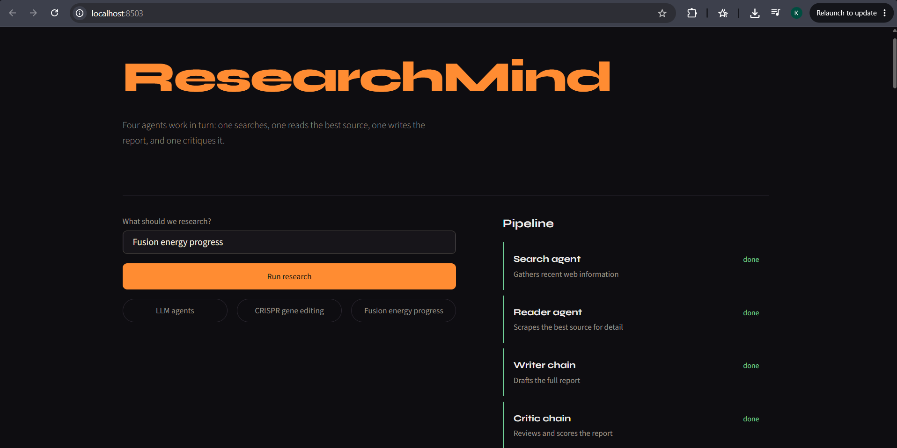
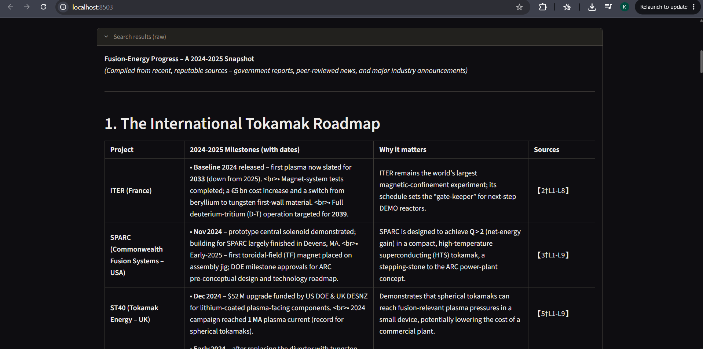
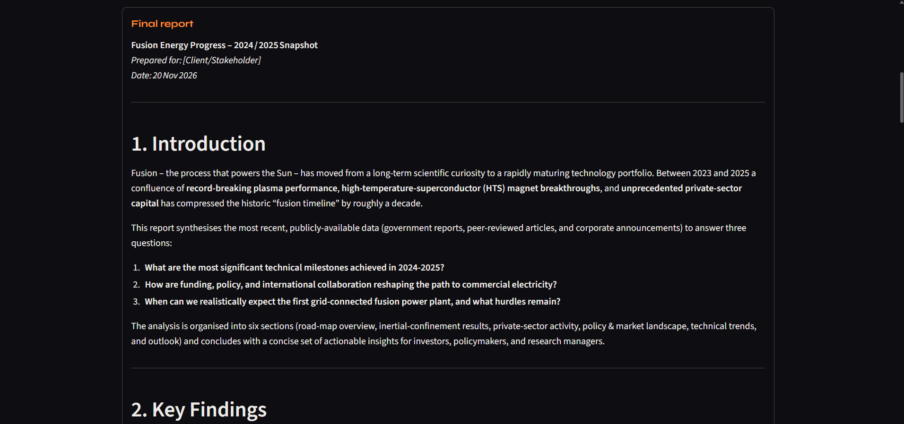
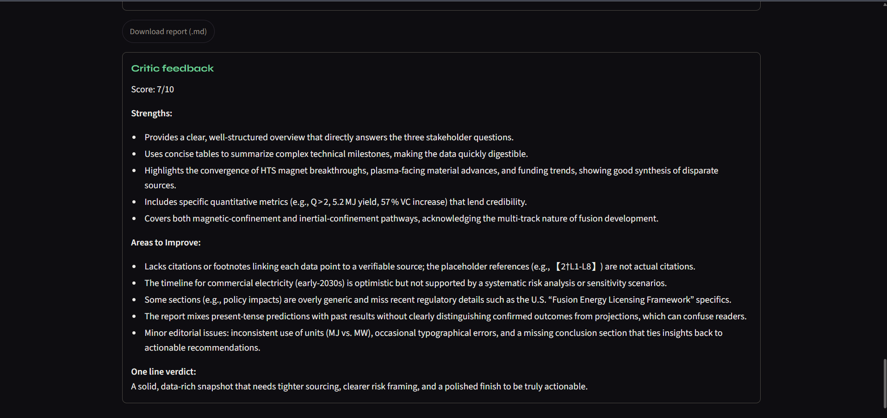

 

# 🔬 ResearchMind

### Multi-Agent AI Research System

An AI-powered research assistant that searches the web, extracts relevant information, generates structured research reports, and evaluates the final output using a multi-agent workflow.

  
  
  
  

---

## 📌 Overview

**ResearchMind** is a multi-agent AI research system designed to automate the process of researching a topic and converting collected information into a structured report.

Unlike a traditional chatbot that relies on a single LLM call, ResearchMind uses specialised agents that collaborate through a sequential workflow.

The system consists of four major stages:

- **Search Agent:** Searches the web for relevant and recent information.
- **Reader Agent:** Extracts detailed content from selected web sources.
- **Writer Chain:** Generates a structured research report.
- **Critic Chain:** Evaluates the generated report and provides feedback.

The application is built using Python, LangChain, Groq, Tavily, and Streamlit.

---

## 🖥️ Application Preview

  
  
<em>ResearchMind interface — enter a research topic and initiate the AI research pipeline.</em>

---

## ✨ Features

- 🤖 **Multi-Agent Architecture** — Multiple specialised agents handle different stages of research.
- 🔎 **Web Search Integration** — Retrieves relevant information from the web.
- 📄 **Content Extraction** — Extracts detailed information from selected web pages.
- ✍️ **Automated Report Generation** — Creates structured reports using LLMs.
- 🧠 **AI-Powered Critic** — Reviews generated reports and provides scores and improvement suggestions.
- 📊 **Pipeline Tracking** — Displays the execution progress of individual agents.
- 📥 **Report Export** — Download generated reports in Markdown format.
- ⚡ **Interactive Interface** — A Streamlit-based interface for running research queries.

---

## ⚙️ How It Works

ResearchMind follows a sequential multi-agent workflow in which each component performs a specialised task.

<pre>
       USER RESEARCH TOPIC
                |
                ▼
       ┌─────────────────┐
       │  SEARCH AGENT   │
       │   Web Search    │
       └────────┬────────┘
                |
                ▼
       ┌─────────────────┐
       │  READER AGENT   │
       │ Content         │
       │ Extraction      │
       └────────┬────────┘
                |
                ▼
       ┌─────────────────┐
       │  WRITER CHAIN   │
       │ Report          │
       │ Generation      │
       └────────┬────────┘
                |
                ▼
       ┌─────────────────┐
       │  CRITIC CHAIN   │
       │ Report          │
       │ Evaluation      │
       └────────┬────────┘
                |
                ▼
        FINAL RESEARCH REPORT
           + CRITIC FEEDBACK
</pre>

### 1. Search Agent

Searches the web for recent and relevant information based on the user's research topic.

### 2. Reader Agent

Processes the search results, selects a relevant source, and extracts detailed content from the selected webpage.

### 3. Writer Chain

Uses the collected research information to generate a structured report containing relevant sections, findings, and supporting information.

### 4. Critic Chain

Evaluates the generated report and provides:

- Numerical evaluation score.
- Strengths of the report.
- Areas that need improvement.
- Overall feedback and suggestions.

---

## 📸 Project Screenshots

### 1. Research Pipeline

  
  
<em>Search results and live execution status of the multi-agent research pipeline.</em>

### 2. Generated Research Report

  
  
<em>A structured research report generated from collected web information.</em>

### 3. AI Critic Feedback

  
  
<em>The Critic Chain evaluates the report, assigns a score, and highlights strengths and weaknesses.</em>

---

## 🛠️ Technology Stack

<table>
  <tr>
    <th>Technology</th>
    <th>Purpose</th>
  </tr>
  <tr>
    <td>Python</td>
    <td>Core programming language</td>
  </tr>
  <tr>
    <td>LangChain</td>
    <td>LLM orchestration and chain development</td>
  </tr>
  <tr>
    <td>Groq</td>
    <td>LLM inference and model integration</td>
  </tr>
  <tr>
    <td>Streamlit</td>
    <td>Interactive web application interface</td>
  </tr>
  <tr>
    <td>Tavily</td>
    <td>Web search integration</td>
  </tr>
  <tr>
    <td>BeautifulSoup</td>
    <td>Webpage content extraction</td>
  </tr>
  <tr>
    <td>Requests</td>
    <td>HTTP requests</td>
  </tr>
  <tr>
    <td>python-dotenv</td>
    <td>Environment variable management</td>
  </tr>
  <tr>
    <td>uv</td>
    <td>Python dependency and environment management</td>
  </tr>
</table>

---

## 📂 Project Structure

<pre>
Multi-agent-system/
│
├── assets/
│   └── screenshots/
│       ├── researchmind-home.png
│       ├── research-pipeline.png
│       ├── generated-report.png
│       └── critic-feedback.png
│
├── src/
│   └── rag_project/
│       └── __init__.py
│
├── agents.py
├── app.py
├── pipeline.py
├── tools.py
│
├── .env.example
├── .gitignore
├── .python-version
├── pyproject.toml
├── requirements.txt
├── uv.lock
└── README.md
</pre>

---

## 🚀 Installation and Setup

### Prerequisites

- Python (use a version compatible with the project configuration).
- uv package manager.
- Groq API key.
- Tavily API key.

### Step 1: Clone the Repository

<pre><code>git clone https://github.com/krrishhxd/Multi-agent-system.git

cd Multi-agent-system</code></pre>

### Step 2: Install Dependencies

Install the project dependencies using uv:

<pre><code>uv sync</code></pre>

### Step 3: Configure Environment Variables

Create a `.env` file in the root directory of the project.

Add your API keys:

<pre><code>GROQ_API_KEY=your_groq_api_key
TAVILY_API_KEY=your_tavily_api_key</code></pre>

Make sure the variable names match the ones used in your source code.

### Step 4: Run the Application

<pre><code>uv run streamlit run app.py</code></pre>

The application will start locally, usually at:

<pre><code>http://localhost:8501</code></pre>

---

## 🔑 API Configuration

ResearchMind uses external API services for its research and language model capabilities.

<table>
  <tr>
    <th>Service</th>
    <th>Purpose</th>
    <th>Website</th>
  </tr>
  <tr>
    <td>Groq</td>
    <td>LLM inference</td>
    <td><a href="https://console.groq.com/">Groq Console</a></td>
  </tr>
  <tr>
    <td>Tavily</td>
    <td>Web search</td>
    <td><a href="https://tavily.com/">Tavily</a></td>
  </tr>
</table>

**Security Note:** Never commit your `.env` file or expose API keys in your repository. Keep sensitive credentials in environment variables.

---

## 🔮 Future Improvements

- [ ] Add source-level citations and reference validation.
- [ ] Implement fact-checking and claim verification.
- [ ] Introduce parallel agent execution.
- [ ] Add PDF report export.
- [ ] Implement persistent research history.
- [ ] Improve source ranking and relevance evaluation.
- [ ] Add human-in-the-loop report review.

---

## 🎯 Learning Outcomes

Working on ResearchMind provided practical experience in:

- Building multi-agent AI applications.
- Integrating LLMs with external tools and APIs.
- Designing sequential AI workflows.
- Web search and webpage content extraction.
- Generating structured outputs using LLM chains.
- Evaluating AI-generated content.
- Developing interactive AI applications using Streamlit.

---

## 👨‍💻 Author

### Krishnendu Das

B.Tech — Computer Science and Engineering (AI & ML)

<a href="https://github.com/krrishhxd">GitHub Profile</a>

---

**If you find ResearchMind interesting, consider giving this repository a ⭐!**

